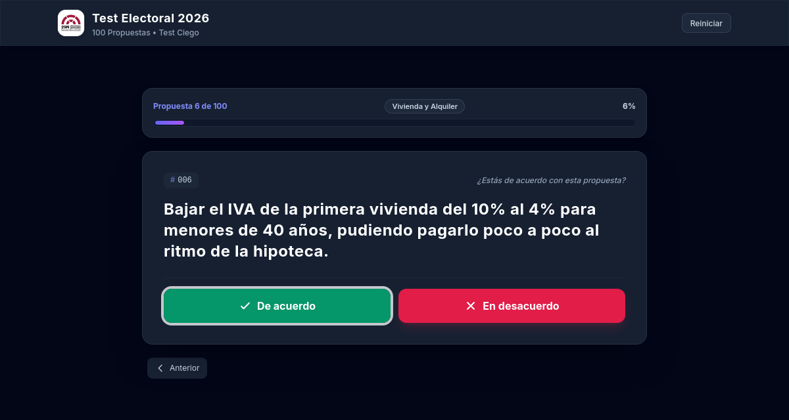
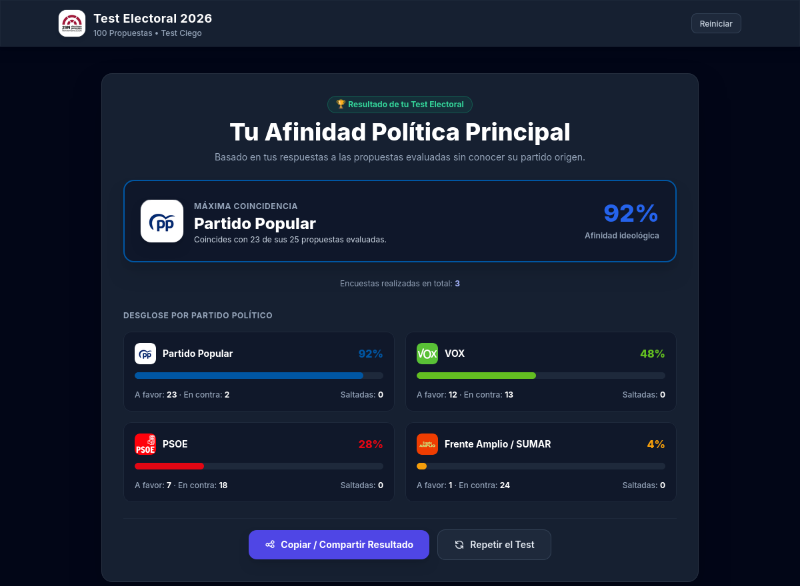
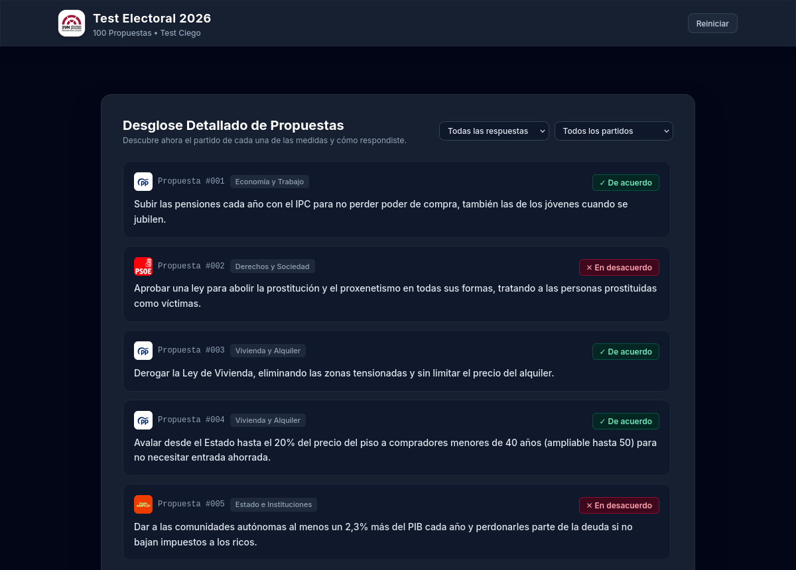

# Test Electoral España 2026

Aplicación web tipo PWA para descubrir tu afinidad política mediante un **test ciego de 100 propuestas**: 25 del PP, 25 del PSOE, 25 de VOX y 25 de Frente Amplio / SUMAR. Durante el test no se muestra el partido de cada propuesta; al finalizar se revela el porcentaje de coincidencia con cada formación y el detalle de todas tus respuestas.

**Demo:** https://test-electoral-espana.45.79.220.248.sslip.io/

> Proyecto informativo y pedagógico, sin afiliación política. Las propuestas se extrajeron de programas oficiales y los logotipos son marcas de sus respectivos partidos.

## Características

- Test ciego de 100 propuestas, equilibrado 25/25/25/25.
- Modo completo o rápido (20 propuestas: 5 por partido).
- Orden aleatorio opcional.
- Resultados con porcentaje de afinidad y desglose por partido.
- Lista detallada de propuestas con filtros por respuesta y por partido.
- Copiar y compartir el resultado.
- Progreso persistente en `localStorage`.
- PWA instalable con icono propio e identidad visual 29N, y funcionamiento offline mediante service worker.
- Valoración global de la app (1–5 estrellas) y contador global de encuestas realizadas.

## Capturas

> Capturas con datos de la demo.

### Portada


### Test ciego



### Resultados



### Desglose detallado



## Cómo se calcula la afinidad

Para cada partido:

```text
matchPercent = acuerdos / (acuerdos + desacuerdos) * 100
```

Las propuestas saltadas son neutrales: se excluyen del denominador. Si no se evaluó ninguna propuesta de un partido, su porcentaje es 0.

## Stack

- HTML, CSS y JavaScript vanilla.
- Tailwind CSS por CDN con configuración inline.
- PWA: `manifest.json` y `sw.js`.
- Backend mínimo en PHP 8 para estadísticas globales.
- Persistencia en JSON fuera del directorio público.

No hay build, gestor de paquetes ni tests automatizados.

## Estructura

```text
.
├── index.html                 # UI, estilos, lógica y dataset de propuestas
├── manifest.json              # Manifest PWA
├── sw.js                      # Service worker (caché v11)
├── elecciones.png             # Logo/icono fuente y icono 512×512
├── icon-29n-192.png
├── icon-29n-maskable-512.png
├── pp.png
├── psoe.png
├── vox.png
├── frenteamplio.png
├── assets/
│   ├── video-thumbnail.jpg
│   └── screenshots/
│       ├── portada.png
│       ├── test.png
│       ├── resultados.png
│       └── desglose.png
├── api/
│   ├── rating.php             # GET estadísticas / POST valoración
│   └── survey.php             # GET contador / POST incremento
├── deploy/
│   └── test-electoral-espana.conf
├── deploy.sh
└── AGENTS.md
```

## Desarrollo local

Sirve el proyecto por HTTP para que funcione el service worker:

```bash
python3 -m http.server 8000
```

Abre <http://localhost:8000/>.

`python3 -m http.server` no ejecuta PHP. Para probar también la API:

```bash
mkdir -p ./data
RATINGS_DIR=./data SURVEYS_DIR=./data php -S 127.0.0.1:8000
```

Requiere PHP 8. Si no hay PHP disponible, la app funciona igual: la valoración muestra «Estadísticas no disponibles» y el contador global mantiene su placeholder «—».

## API

### Valoraciones

```http
GET /api/rating.php
```

```json
{
  "ok": true,
  "count": 12,
  "average": 4.42,
  "distribution": { "1": 0, "2": 1, "3": 1, "4": 3, "5": 7 }
}
```

```http
POST /api/rating.php
Content-Type: application/json

{ "rating": 5, "clientId": "uuid-o-id-local" }
```

La valoración se deduplica por `clientId`: volver a valorar actualiza la nota del mismo navegador sin aumentar el contador.

### Encuestas realizadas

```http
GET /api/survey.php
```

```json
{ "ok": true, "count": 34 }
```

```http
POST /api/survey.php
Content-Type: application/json

{ "clientId": "uuid-o-id-local" }
```

Incrementa el contador una vez por test completado y devuelve el nuevo total. Las repeticiones del test cuentan como nuevas encuestas.

Los datos se guardan en `/var/lib/test-electoral-espana/ratings.json` y `/var/lib/test-electoral-espana/surveys.json`, fuera del DocRoot. Las rutas se pueden cambiar con las variables de entorno `RATINGS_DIR` y `SURVEYS_DIR`.

## Despliegue

Resumen (los detalles están en `AGENTS.md`):

```bash
SSHPASS_FILE=/ruta/al/secreto ./deploy.sh
```

El script sincroniza con `rsync`, instala el vhost una única vez, recarga Apache y emite el certificado con certbot en el primer despliegue. No se debe volver a subir el vhost después de certbot. No se almacenan credenciales en el repositorio.

## Créditos

- Inspirado en el vídeo «Test elecciones 2026 - 100 propuestas para ESPAÑA» de [NOTICIAS ILUSTRADAS](https://www.youtube.com/@NOTICIASILUSTRADAS).
- Idea y programación: [EdFasano70](https://github.com/edfasano70).

## Aviso

Este proyecto es independiente y no está vinculado a ningún partido político. Su finalidad es informativa y pedagógica. No sustituye a una encuesta electoral oficial ni a la consulta de los programas electorales completos.
